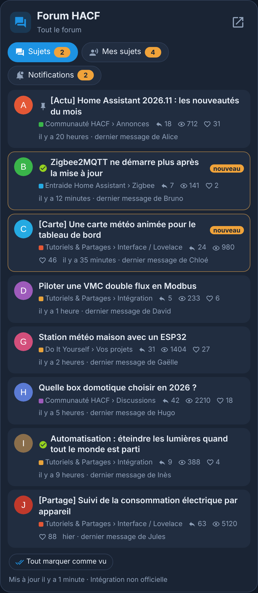
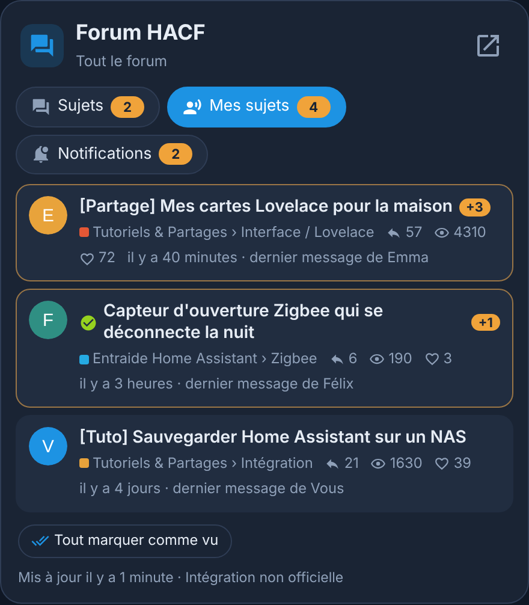
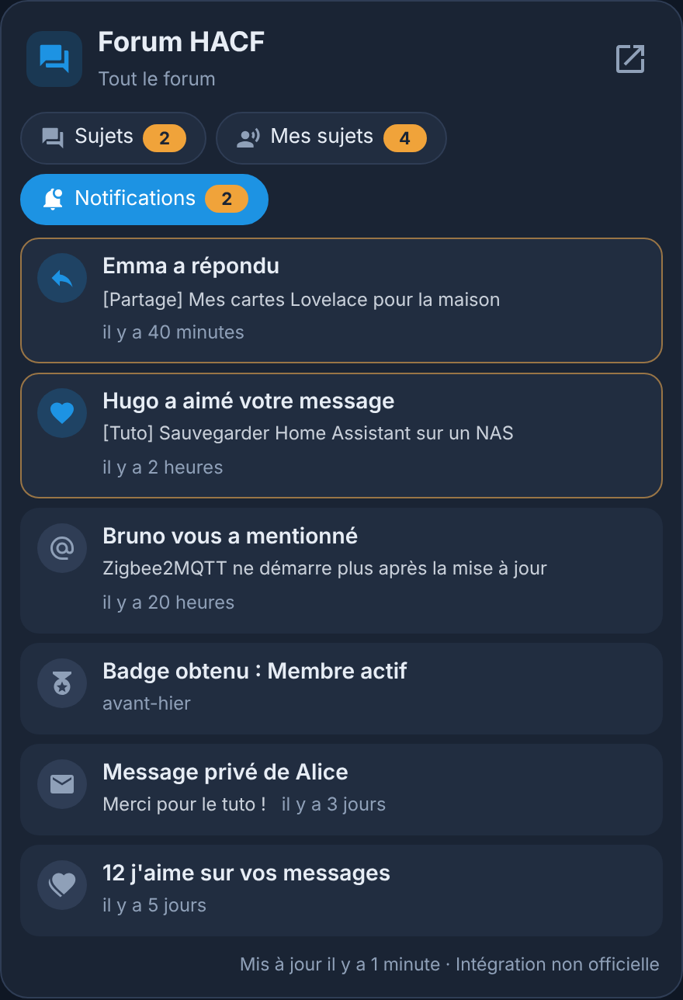

# Forum HACF pour Home Assistant

<p>
  ☕ <strong>Si cette carte vous est utile, vous pouvez soutenir le projet :</strong>
</p>

<div style="white-space: nowrap; line-height: 0;">
  <a
    href="https://www.buymeacoffee.com/Marlboro62"
    target="_blank"
    rel="noopener noreferrer"
    style="display: inline-block; text-decoration: none; vertical-align: middle;"
  ></a>&nbsp;&nbsp;<a
    href="https://ko-fi.com/M4M2QL45X"
    target="_blank"
    rel="noopener noreferrer"
    style="display: inline-block; text-decoration: none; vertical-align: middle;"
  ></a>
</div>

Intégration et carte **non officielles** pour suivre le [forum HACF](https://forum.hacf.fr) (communauté francophone de Home Assistant) depuis votre tableau de bord : **derniers sujets**, **vos sujets** et **vos notifications**, ainsi que les **actualités du site hacf.fr**.

> Ce projet n'est pas affilié à HACF. Il lit les pages publiques du forum et, si vous le choisissez, vos notifications avec un accès en lecture seule que vous pouvez retirer à tout moment.

🎮 **[Essayer la démo en ligne](https://marlboro62.github.io/hacf-forum/docs/demo.html)** : la vraie carte avec des sujets, des membres et des notifications fictifs, sans installer Home Assistant (sombre ou clair, trois langues, compte relié ou non).

<p align="center">
  
  
  
</p>

<p align="center"><em>Captures de la démo : sujets, membres et notifications fictifs.</em></p>

## Fonctionnalités

- **Derniers sujets** : tout le forum ou une catégorie au choix, avec la catégorie, les réponses, les vues, les « j'aime », l'heure et l'auteur du dernier message. Les sujets actifs depuis votre dernière visite sont marqués **nouveau**.
- **Mes sujets** : les sujets ouverts par votre pseudo, avec le nombre de **nouvelles réponses** (+3) depuis votre dernière visite.
- **Notifications** (compte relié, facultatif) : mentions, réponses, citations, « j'aime », messages privés, badges… Les non lues sont mises en avant, leur nombre s'affiche sur l'onglet.
- **Actus** : les articles de la rubrique [Actualités du site hacf.fr](https://www.hacf.fr/tag/news/) (nouvelles versions, événements, newsletters), avec image, résumé et date. Les nouveaux articles depuis votre dernière visite sont marqués **nouveau**.
- Un clic sur une ligne ouvre le sujet ou le message sur le forum, dans un nouvel onglet.
- **La carte s'installe avec l'intégration** : aucune ressource à ajouter dans les tableaux de bord.
- Interface en **français**, **anglais** et **polonais** (langue de Home Assistant).
- Couleurs : bleu nuit (style des cartes MyElectricalData), version claire automatique, ou thème de Home Assistant.

## Installation

### Depuis la Marketplace (dépôt personnalisé)

1. Dans **Paramètres › Marketplace** (ou HACS avant Home Assistant 2026.11), menu **⋮** → **Dépôts personnalisés** : adresse `https://github.com/Marlboro62/hacf-forum`, type **Intégration**.
2. Cherchez **HACF Forum**, téléchargez-la, puis **redémarrez Home Assistant**.

HACF Forum n'est pas dans la liste par défaut de la Marketplace (elle n'accepte que des projets open source) : il s'ajoute toujours par l'adresse du dépôt, comme ci-dessus.

### Ajouter l'intégration

1. **Paramètres › Appareils et services › Ajouter une intégration › HACF Forum**.
2. **Pseudo sur le forum HACF** : facultatif, pour l'onglet « Mes sujets ».
3. Choisissez **Relier mon compte HACF** pour les notifications, ou **Terminer** (c'est possible plus tard dans les options).
4. **Rechargez la page** du navigateur (Ctrl+F5) : la carte **Forum HACF** apparaît alors dans la liste des cartes.

### Relier votre compte (notifications, facultatif)

1. Connectez-vous au forum HACF dans votre navigateur.
2. Dans Home Assistant, ouvrez le lien **« cette page d'autorisation »** affiché par l'intégration.
3. Sur le forum, cliquez sur **Autoriser** : un long texte s'affiche.
4. Copiez **tout** ce texte et collez-le dans Home Assistant.

L'accès est **en lecture seule** (sujets et notifications) : l'intégration ne peut ni écrire, ni répondre, ni modifier votre compte. Le texte affiché par le forum est chiffré pour votre Home Assistant seulement. Pour retirer l'accès : profil du forum › **Préférences › Sécurité › Applications**, et dans Home Assistant **Configurer › Délier mon compte HACF**.

## La carte

```yaml
type: custom:hacf-forum-card
```

Elle trouve seule les capteurs de l'intégration. Elle est aussi proposée dans la liste des cartes (**Forum HACF**), avec un éditeur visuel.

| Option | Rôle | Défaut |
| --- | --- | --- |
| `title` | Titre | `Forum HACF` |
| `show_latest`, `show_mine`, `show_notifications`, `show_news` | Onglets affichés | `true` |
| `max_items` | Nombre de lignes visibles par onglet | `10` |
| `scroll` | Faire défiler la liste pour voir les lignes suivantes (sinon la liste s'arrête à `max_items`) | `true` |
| `show_avatars` | Avatar de l'auteur du dernier message | `true` |
| `theme` | `v2` (bleu nuit), `auto` (clair si Home Assistant est en mode clair) ou `ha` (thème de Home Assistant) | `v2` |
| `language` | `auto`, `fr`, `en` ou `pl` | `auto` |

Le bouton **Tout marquer comme vu** remet à zéro les « nouveau » et « +N » de l'onglet affiché (mémorisés dans le navigateur). Quand des nouveautés sont plus bas dans la liste, le bouton **↓ N nouveau(x) plus bas** y descend directement.

Le nombre de sujets lus sur le forum se règle dans les options de l'intégration (**Nombre de sujets**, 20 par défaut) : augmentez-le si vous voulez faire défiler plus loin.

## Options de l'intégration

**Paramètres › Appareils et services › HACF Forum › Configurer** :

- **Catégorie suivie** pour les derniers sujets (« — » : tout le forum) ;
- **Nombre de sujets** gardés (5 à 50, 20 par défaut) ;
- **Fréquence de mise à jour** (10 minutes par défaut, 5 au minimum pour ménager le forum) ;
- **Actualités du site hacf.fr** (activé par défaut) : le flux est relu toutes les 3 heures ;
- **Relier** ou **délier** votre compte.

## Capteurs

| Capteur | État | Attributs |
| --- | --- | --- |
| Derniers sujets | Sujets actifs ces dernières 24 heures | `topics`, `category`, `forum_url` |
| Mes sujets | Nombre de vos sujets | `topics`, `username`, `forum_url` |
| Notifications | Notifications non lues | `notifications`, `account`, `forum_url` |
| Actualités hacf.fr | Date du dernier article | `articles`, `last_title`, `news_url` |

Les listes (`topics`, `notifications`, `articles`) ne sont pas enregistrées dans l'historique de Home Assistant. Le capteur **Notifications** peut servir à une automatisation (par exemple, une notification sur le téléphone quand il augmente), tout comme **Actualités hacf.fr**, qui change à chaque nouvel article.

## Vie privée

- Seul votre Home Assistant contacte `forum.hacf.fr`, toutes les 10 minutes par défaut, et `www.hacf.fr` (actualités) toutes les 3 heures.
- La clé du compte reste dans Home Assistant ; elle est retirée des **diagnostics**, comme votre pseudo.
- Les avatars et les images des articles sont chargés depuis le forum et le site par votre navigateur.

## Historique des versions

### 0.3.1b2

- 🐛 **Correction** : la limite de 60 % de la hauteur de l'écran ne s'applique plus qu'aux téléphones ; sur tablette et ordinateur, la liste affiche de nouveau les `max_items` lignes demandées ([#2](https://github.com/Marlboro62/hacf-forum/issues/2)).

### 0.3.1b1

- 🐛 **Correction** : sur un téléphone, la liste pouvait occuper tout l'écran et le bouton **Tout marquer comme vu** restait inaccessible. La liste ne dépasse plus 60 % de la hauteur de l'écran, et le défilement passe à la page quand on arrive en bas de la liste. Merci @JourMic ([#2](https://github.com/Marlboro62/hacf-forum/issues/2)).

### 0.3.0

- ✨ **Nouveauté** : défilement de la liste dans la carte (option `scroll`, active par défaut). La carte garde la hauteur de `max_items` lignes et tous les sujets récupérés restent accessibles en faisant défiler ; bouton **↓ N nouveau(x) plus bas** pour aller aux nouveautés cachées. Merci @JourMic pour l'idée et les tests ([#1](https://github.com/Marlboro62/hacf-forum/issues/1)).
- 🐛 **Correction** : la hauteur de la liste est mesurée dès que la carte s'affiche (avant, tous les sujets pouvaient apparaître jusqu'au rafraîchissement suivant).
- 📜 **Licence** : première version stable sous licence « Tous droits réservés » (voir plus bas).

### 0.2.0

- ✨ **Nouveauté** : onglet **Actus** avec les articles de la rubrique Actualités de hacf.fr (image, résumé, date, auteur, badge **nouveau**).
- ➕ **Ajouts** : capteur **Actualités hacf.fr** (date du dernier article), option d'intégration pour activer ou couper les actualités, option de carte `show_news`, démo mise à jour.
- 🐛 **Correction** : flux des actualités lu en entier (onglet vide dans la première bêta).

### 0.1.0

- ✨ Première version stable : onglets **Sujets**, **Mes sujets** et **Notifications** (compte relié en lecture seule), carte installée avec l'intégration, français, anglais et polonais.
- 🐛 Carte chargée même quand l'interface démarre après l'intégration ; « dernier message de … » sous chaque sujet ; nom de badge non répété.

Détail de chaque version : [releases](https://github.com/Marlboro62/hacf-forum/releases).

## Signaler un problème

Ouvrez une [issue GitHub](https://github.com/Marlboro62/hacf-forum/issues), avec les **diagnostics** de l'intégration (téléchargeables depuis sa page). Ne collez jamais le texte affiché par le forum lors de l'autorisation.

## Licence et droits d'auteur

**© 2026 Marlboro62. Tous droits réservés.** Marlboro62 est l'auteur et le **seul titulaire** de ce projet : code, carte, textes, documentation, images et icônes.

- ✅ **Autorisé** : installer et utiliser gratuitement l'intégration et la carte dans votre propre Home Assistant, pour un usage personnel ; signaler un problème ou proposer une idée dans les [issues](https://github.com/Marlboro62/hacf-forum/issues).
- ⛔ **Interdit sans mon accord écrit** : copier, partager, diffuser ou republier le projet ailleurs que depuis ce dépôt, le modifier ou en faire une version dérivée, le reprendre comme modèle, ou l'utiliser à des fins commerciales.

Ces interdictions s'appliquent à toute personne, association ou organisation, **y compris l'association HACF**, qui ne peut ni copier, ni reprendre, ni modifier, ni diffuser ce projet sans mon accord écrit.

Conditions complètes : [LICENSE](LICENSE). Les versions publiées jusqu'à la 0.3.0b2 incluse restent sous licence MIT ; la licence « Tous droits réservés » s'applique à partir de la 0.3.0.

Le nom HACF désigne le forum suivi : ce projet est indépendant, il n'est ni produit ni validé par l'association HACF.
